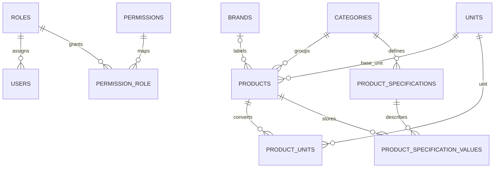

# TokoBangunan POS

Fondasi aplikasi kasir toko bangunan berbasis Laravel 13, Livewire 4, Blade, Tailwind CSS 3, dan Vite 6. Antarmuka menggunakan Bahasa Indonesia dan zona waktu Asia/Jakarta.

## Tahap 1: fondasi

Tahap pertama menyediakan login/logout, role Admin/Kasir/Pemilik, middleware permission di server, dan layout dashboard responsif. Tahap kedua menyediakan kategori, satuan, katalog barang, harga, barcode, satuan dasar, dan atribut produk fleksibel per kategori. Data contoh yang di-seed hanya kategori konstruksi dan satuan umum; tidak ada transaksi atau stok dummy. Modul stok dan transaksi belum dibuat.

## Menjalankan lokal

Persyaratan: PHP 8.3+, Composer, Node.js, npm, serta MySQL 8 (atau SQLite untuk pengembangan lokal sementara).

```bash
composer install
npm install
cp .env.example .env
php artisan key:generate
```

Atur kredensial database di `.env`. Untuk MySQL, buat database `tokobangunan_pos` terlebih dahulu dan gunakan pengguna database khusus aplikasi. Setelah itu:

```bash
php artisan migrate --seed
npm run build
php artisan serve --host=0.0.0.0
```

Buka `http://127.0.0.1:8000/login`. Untuk sementara, folder kerja ini memakai SQLite karena server MySQL lokal menolak koneksi tanpa kredensial. File `database/database.sqlite` adalah basis data pengembangan; `.env.example` sudah disiapkan untuk MySQL.

Setelah migrasi dan seeding role, buat pengguna admin pertama dengan kredensial pilihan sendiri:

```bash
php artisan tinker
```

```php
$role = App\Models\Role::where('name', 'admin')->firstOrFail();
App\Models\User::create(['name' => 'Administrator', 'email' => 'admin@tokobangunan.local', 'password' => Illuminate\Support\Facades\Hash::make('GANTI-DENGAN-KATA-SANDI-KUAT'), 'role_id' => $role->id]);
```

Ganti email dan kata sandi contoh sebelum dipakai. Jangan gunakan akun lokal pengembangan untuk operasional.

## Katalog dan spesifikasi produk

Kategori, satuan, barang, dan atribut spesifikasi dikelola dari dashboard. Admin dapat mengubah katalog; kasir dan pemilik dapat melihat katalog. Barang yang diarsipkan memakai soft delete. Satuan atau kategori yang masih dipakai tidak dapat dihapus. Satuan yang dipakai produk akan dinonaktifkan jika diminta dihapus.

Spesifikasi kategori mendukung teks, angka desimal, bilangan bulat, atau ya/tidak. Kategori besi rakitan awal telah disediakan dengan atribut ukuran dan berat yang dapat disesuaikan, misalnya cakar ayam, begel, sloof, kawat, serta wiremesh.

## ERD fondasi dan katalog



## Akses berbasis role

Gunakan middleware pada route, misalnya `->middleware(['auth', 'permission:inventory.manage'])`. Permission juga dapat diperiksa di kebijakan/controller dengan `$user->hasPermission('inventory.manage')`. Menyembunyikan menu saja tidak memberi perlindungan endpoint.

## Validasi lokal

```bash
php artisan migrate:fresh --seed
php artisan test
npm run build
```

`migrate:fresh` menghapus tabel dan data lokal, jadi gunakan hanya pada basis data pengembangan.
